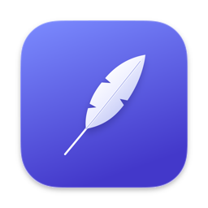

<p align="center"></p>

# Plume

Plume, c'est la dictée vocale pour Mac. Appuyez sur une touche, parlez, appuyez de nouveau : le texte s'écrit là où se trouve le curseur.

La reconnaissance se fait sur votre Mac, votre voix n'en sort pas. Ça marche dans toutes les apps : mail, notes, messagerie, navigateur, terminal.

[Télécharger Plume](https://github.com/ppocass/plume/releases/latest/download/Plume.dmg) | [Site](https://plume-vert.vercel.app) | [English](README.md)

## Installation

1. Ouvrez `Plume.dmg` et glissez Plume dans Applications.
2. Ouvrez Plume. macOS dira qu'il ne peut pas vérifier le développeur, car Plume n'est pas signée avec un compte développeur Apple payant. Allez dans Réglages Système > Confidentialité et sécurité, descendez et cliquez sur **Ouvrir quand même**.
3. Autorisez le **Micro** (pour vous entendre) et l'**Accessibilité** (pour le raccourci et pour écrire le texte). L'assistant vous guide.

Au premier lancement, Plume télécharge son modèle de voix (environ 630 Mo pour celui par défaut). Ensuite, elle marche hors ligne.

## Utilisation

- Appuyez une fois sur votre touche de raccourci pour commencer, une fois pour finir (**fn** par défaut). Le texte s'écrit là où est le curseur.
- Deux appuis rapides annulent.
- Pas de champ de texte sous le curseur ? Le texte est gardé dans l'Historique, un clic le copie.

Le raccourci se change dans les Réglages, n'importe quelle touche convient. Avec fn, réglez Réglages Système > Clavier > « Appuyer sur la touche 🌐 » sur « Ne rien faire », sinon macOS ouvre aussi les emojis.

## Modèles

L'assistant choisit le modèle qui convient à votre Mac. Vous pouvez en changer dans la page Modèles.

- **Parakeet Ultra** (par défaut) : 25 langues européennes, sur la puce neuronale, très rapide même avec 8 Go.
- **Whisper Turbo, Turbo compact et Large v3** : 99 langues, et ils tiennent compte de votre vocabulaire. Mieux sur un Mac de 16 Go ou plus.
- **En ligne** : l'audio part chez Groq, OpenAI ou un service compatible, avec votre propre clé API.

Chaque modèle vient de Hugging Face, à une révision figée, et son empreinte SHA-256 est vérifiée avant usage.

## Nettoyage du texte (facultatif)

Plume peut corriger la ponctuation et retirer les « euh » avec un modèle de langage. Il faut votre propre clé API. Une clé gratuite [Groq](https://console.groq.com/keys) suffit : collez-la dans Réglages > Nettoyage. Seul le texte est envoyé, jamais la voix, et seulement si le nettoyage est activé. Sans clé, vous avez le texte brut.

## Mises à jour

Plume regarde sur GitHub s'il y a une nouvelle version, une fois par jour (désactivable dans Réglages > Mises à jour). Un clic l'installe à la place de l'ancienne. Vos réglages, votre historique, votre vocabulaire, vos modèles et vos clés API sont conservés, tout comme les autorisations Micro et Accessibilité. Les grosses versions montrent un court écran « Nouveautés ».

## Vie privée

- Votre voix est traitée sur votre Mac (sauf si vous choisissez le modèle En ligne).
- Le micro n'est ouvert que pendant la dictée.
- L'historique (200 dernières dictées) et le vocabulaire restent dans `~/Library/Application Support/Plume`.
- Les clés API sont rangées dans le trousseau de macOS.
- Ni statistiques, ni compte.

## Configuration requise

- Un Mac Apple Silicon (M1 ou plus récent)
- macOS 14 Sonoma ou plus récent

## Compiler soi-même

Il faut les outils en ligne de commande de Xcode et `cmake` (`brew install cmake`).

```sh
git clone https://github.com/ppocass/plume.git
cd plume
./make-dmg.sh        # compile Plume, parakeet-server et whisper-server, puis dist/Plume.dmg
./make-app.sh        # ou : compile et installe directement dans ~/Applications
```

## Licence

Plume est sous licence MIT. Elle embarque [FluidAudio](https://github.com/FluidInference/FluidAudio) (Apache 2.0) et [whisper.cpp](https://github.com/ggml-org/whisper.cpp) (MIT). Les modèles Parakeet sont de NVIDIA et moondream, sous CC BY 4.0. Détails dans [THIRD-PARTY-NOTICES.md](THIRD-PARTY-NOTICES.md).
